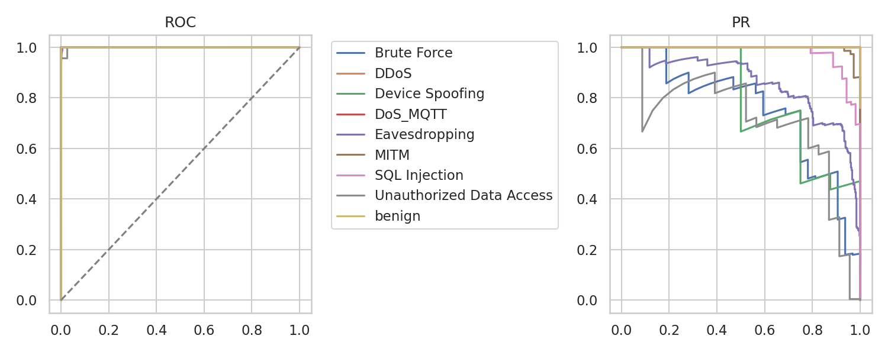
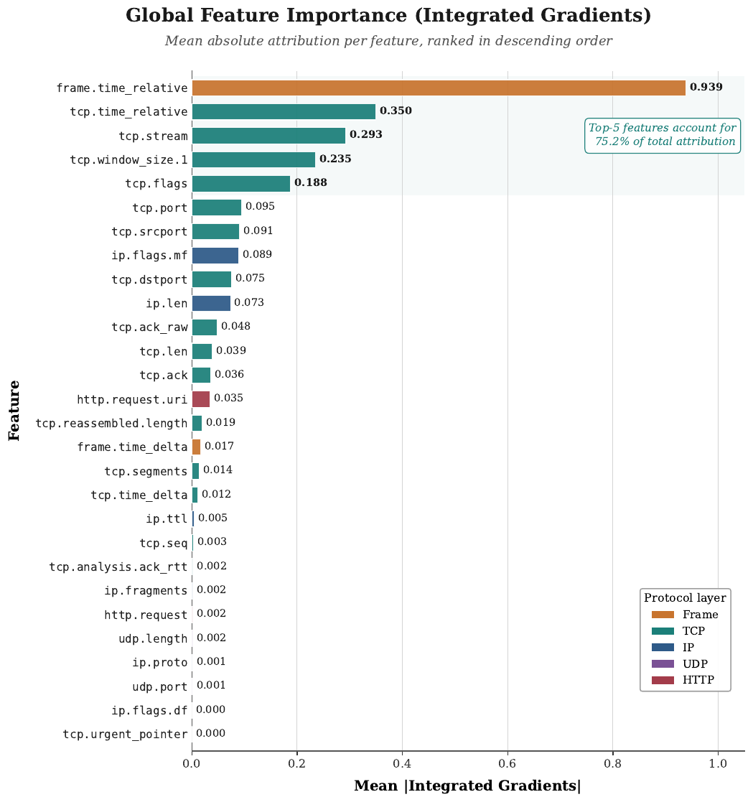
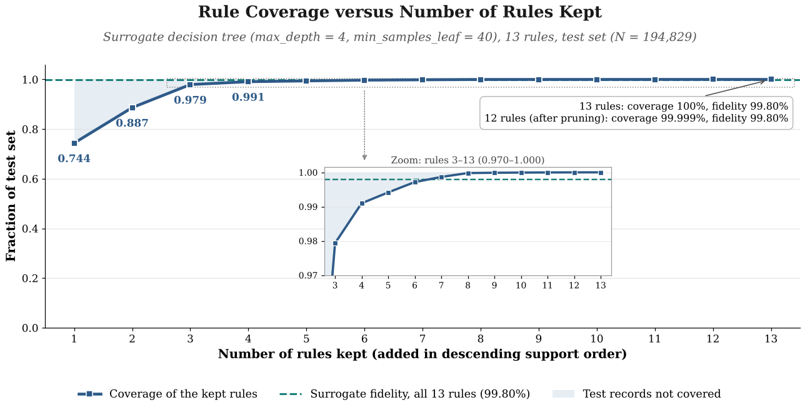
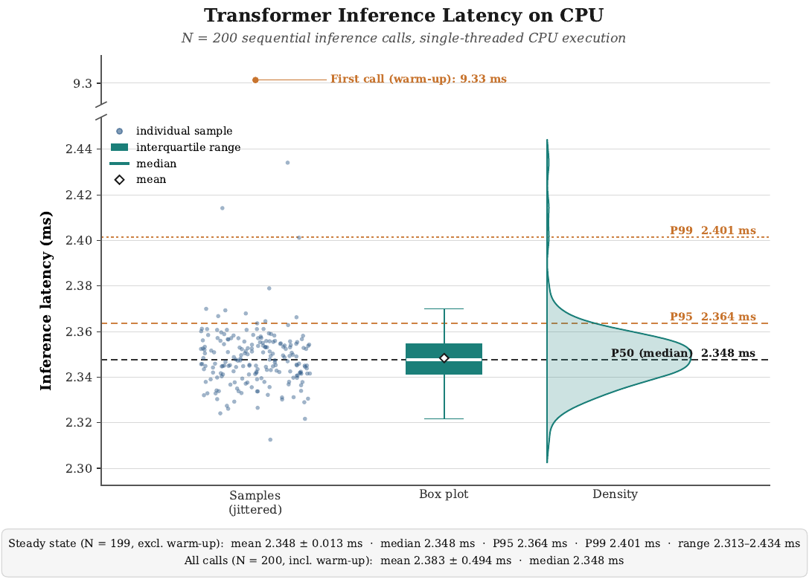

# ExAI5G: result data and figures

Result files and figures for the article:

> Saeid Sheikhi, Panos Kostakos, Lauri Lovén. **ExAI5G: A Logic-Based Explainable AI Framework for Intrusion Detection in 5G Networks.** *Journal, year and DOI will be added on publication.*

Every number from the paper listed below can be recomputed from the files in [`data/`](data) with one command (see [Check the numbers](#check-the-numbers)).

## Contents

| In the paper | What it reports | Data | Figure |
|---|---|---|---|
| Table 3, Section 5.1 | Per-class precision, recall, F1 and support on the test set; accuracy 99.87%; macro-F1 0.854 | [`classification_report.csv`](data/classification_report.csv), [`summary.json`](data/summary.json) | |
| Table 4, Section 5.2 | Macro-F1 of the Decision Tree (depth 4), MLP, XGBoost and Random Forest baselines | [`baselines.json`](data/baselines.json) | |
| Figure 4 | ROC and precision–recall curves per class | | [`fig4_roc_pr.png`](figures/fig4_roc_pr.png) |
| Figure 5, Section 5.3 | Mean absolute Integrated Gradients attribution of the 28 features | [`ig_mean.csv`](data/ig_mean.csv) | [`fig5_feature_importance_ig.pdf`](figures/fig5_feature_importance_ig.pdf) |
| Section 5.4, Figure 6 | The 13 surrogate rules: test-set support, coverage, fidelity, pruning and redundancy | [`rules.csv`](data/rules.csv), [`summary.json`](data/summary.json), [`fig6_coverage_by_rules.csv`](data/derived/fig6_coverage_by_rules.csv) | [`fig6_coverage_vs_rules.pdf`](figures/fig6_coverage_vs_rules.pdf) |
| Figure 7, Section 5.8 | Inference latency of 200 sequential calls on CPU | [`latency_ms.csv`](data/latency_ms.csv) | [`fig7_latency_distribution.pdf`](figures/fig7_latency_distribution.pdf) |

```
.
├── data/
│   ├── classification_report.csv
│   ├── summary.json
│   ├── baselines.json
│   ├── ig_mean.csv
│   ├── rules.csv
│   ├── latency_ms.csv
│   └── derived/
│       └── fig6_coverage_by_rules.csv
├── figures/                 Figures 4–7 (PDF for print, PNG for preview)
├── scripts/
│   ├── check_paper_numbers.py
│   └── make_fig6.py
├── requirements.txt
├── CITATION.cff
├── LICENSE                  CC BY 4.0 (data and figures)
└── LICENSE-CODE             MIT (scripts)
```

## Check the numbers

Requires Python 3 with numpy and matplotlib (tested with Python 3.11 and 3.13).

```bash
pip install -r requirements.txt
python scripts/check_paper_numbers.py   # recomputes 82 values reported in the paper
python scripts/make_fig6.py             # rebuilds Figure 6 from data/rules.csv and data/summary.json
```

`check_paper_numbers.py` prints one line per value: where it appears in the paper, the value as printed there, and the value recomputed from the data. Values are compared at the precision printed in the paper. The last line reads `82 of 82 checks passed.`

## Data files

The files directly in `data/` are the original, unedited outputs of the evaluation run whose results are reported in the paper. `data/derived/` holds values computed from them by the scripts.

**`classification_report.csv`**: classification report of the Transformer IDS on the test set (194,829 records). The first column is the class; `precision`, `recall` and `f1-score` are per class; `support` is the number of test records of that class. The `accuracy` row repeats the overall accuracy in every column.

**`summary.json`**: headline results.

| Key | Meaning |
|---|---|
| `overall_accuracy`, `macro_F1` | Transformer IDS on the test set |
| `median_latency_ms` | median of `latency_ms.csv` |
| `num_rules` | number of leaves (= rules) of the depth-4 surrogate decision tree |
| `logic_fidelity_cov` | fidelity: share of covered test records for which the rule's class equals the Transformer's prediction |
| `logic_fidelity_eff` | fidelity × coverage |
| `rule_coverage` | share of test records covered by the rules |
| `rule_redundancy` | mean pairwise Jaccard index of the rules' sets of test records |
| `pruned_*` | the same metrics after removing the least-supported rule (12 rules) |
| `baselines` | same values as `baselines.json` |
| `schema_version` | version of this file's format |

**`baselines.json`**: macro-F1 of the baseline classifiers on the stratified validation split. `DT_depth4` is a decision tree of depth 4 trained directly on the labels.

**`ig_mean.csv`**: mean absolute Integrated Gradients attribution per feature, averaged over 100 test records (Section 3). First column: feature name (Wireshark/tshark field); column `0`: attribution.

**`rules.csv`**: one row per rule, that is, per leaf of the surrogate decision tree. `leaf` is the node index in the fitted tree; `support` is the number of test records that fall into that leaf. The supports add up to the test-set size.

**`latency_ms.csv`**: 200 sequential single-record inference times in milliseconds, in call order, in a single column with header `0`. The first value is the warm-up call.

**`derived/fig6_coverage_by_rules.csv`**: the values plotted in Figure 6. Rules are added in descending support order, with cumulative support and coverage.

## Figures

| Figure 4 | Figure 5 |
|---|---|
|  |  |
| **Figure 6** | **Figure 7** |
|  |  |


## Scope

This repository covers the results in Sections 5.1–5.4 and 5.8 of the paper. It does not include:

- the article itself (see the citation above);
- the raw traffic dataset (see [Dataset](#dataset)) or the trained models;
- the CatBoost and LightGBM baseline results in Table 4;
- the LLM-generated explanations and their evaluation (Sections 5.5–5.7). Expert ratings are reported only in aggregate form, as stated in the paper's ethics statement;
- the ablation runs (Tables 9–11), apart from the depth-4 surrogate tree reported in `summary.json`.

## License

Data and figures are licensed under [CC BY 4.0](LICENSE). Scripts are licensed under the [MIT License](LICENSE-CODE).

## Citation

If you use these files, please cite the article:

```bibtex
@article{sheikhi2026exai5g,
  title   = {{ExAI5G}: A Logic-Based Explainable {AI} Framework for Intrusion Detection in {5G} Networks},
  author  = {Sheikhi, Saeid and Kostakos, Panos and Lov{\'e}n, Lauri},
  journal = {Information Sciences},
  pages   = {124382},
  year    = {2026},
  doi     = {10.1016/j.ins.2026.124382},
  url     = {https://doi.org/10.1016/j.ins.2026.124382}
}
```
